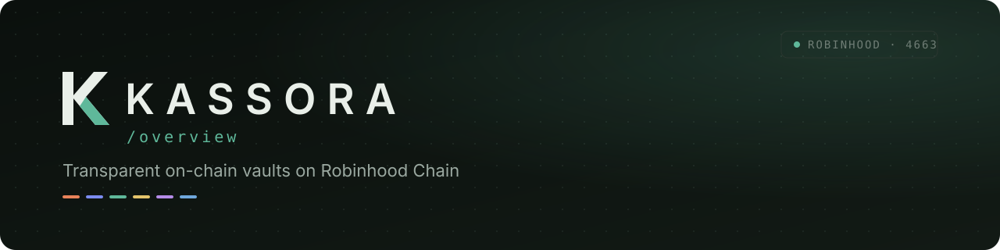
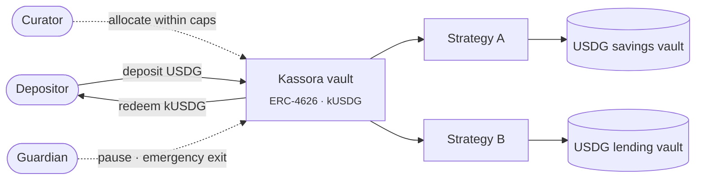
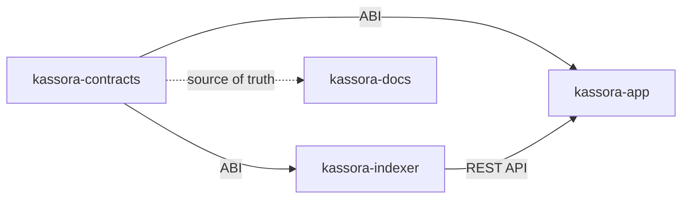

<h3>Transparent on-chain vaults and investment strategies on Robinhood Chain</h3>

  
  
  
  
  
  

  <a href="https://kassora.org"><b>Website</b></a> ·
  <a href="#-what-is-kassora">What is Kassora</a> ·
  <a href="#-how-it-works">How it works</a> ·
  <a href="#-repositories">Repositories</a> ·
  <a href="#-status">Status</a> ·
  <a href="#-security">Security</a>

> [!WARNING]
> Kassora is **pre-launch**. The contracts are **unaudited** and **not deployed**. Nothing here is investment advice, and no return is promised.

## 💡 What is Kassora

Kassora is a vault protocol on [Robinhood Chain](https://docs.robinhood.com/chain/), an Arbitrum Orbit L2 with chain ID `4663` and ETH as gas.

You deposit **USDG** and receive **kUSDG**, a standard ERC-4626 share. A curator puts the deposits to work in **capped strategies**, such as existing USDG savings and lending vaults on the chain. As those strategies earn, the share price rises.

The goal is **transparency you can check yourself**. Every allocation, cap, fee, role holder and pending change lives on-chain and is readable from the contracts.

## ⚙️ How it works

1. **Deposit.** USDG goes into the vault and you receive kUSDG shares.
2. **Allocate.** The curator moves idle USDG into approved strategies, never above each strategy's cap.
3. **Earn.** Strategy yield raises the vault's total assets, and with it the share price.
4. **Withdraw.** Redeem kUSDG at any time. The vault pays from idle USDG first, then pulls from strategies.

## 🛡 Guardrails

| | Guardrail | What it means for depositors |
| --- | --- | --- |
| ⏳ | **Timelock** | New strategies, higher caps, higher fees and a shorter timelock all wait 1 day to 2 weeks. You can see them coming and leave first. |
| 📏 | **Caps** | A total deposit cap and a cap per strategy limit how much is at risk. |
| 🚪 | **Exits stay open** | The guardian can pause deposits, but withdrawals are never paused. |
| 💸 | **Fee ceiling** | The performance fee is hard-capped at 30% of profit in the contract. |
| 🧮 | **Inflation-attack protection** | Virtual shares stop the classic first-depositor attack. |
| 🔑 | **Separated roles** | Owner (multisig), curator and guardian hold different powers. |
| 🚑 | **Emergency paths** | The guardian can pull everything out of a strategy or remove a broken one. |

## 📦 Repositories

| Repo | What it is | Stack |
| --- | --- | --- |
| 🔐 [kassora-contracts](https://github.com/kassora/kassora-contracts) | Vault, strategy interface and adapter, with unit, fuzz, invariant and fork tests | Solidity, Foundry, OpenZeppelin 5 |
| 📈 [kassora-indexer](https://github.com/kassora/kassora-indexer) | Share price, TVL, allocation and governance history behind a REST API | Ponder, viem |
| 🖥 [kassora-app](https://github.com/kassora/kassora-app) | Website, deposit and withdraw app, transparency and contracts pages | Next.js, wagmi |
| 📚 [kassora-docs](https://github.com/kassora/kassora-docs) | How it works, roles, fees, risks and contract addresses | Mintlify |

## 🧭 Status

| Milestone | Status |
| --- | --- |
| Vault and strategy contracts | ✅ Written and tested |
| Indexer and REST API | ✅ Built, tested on a local chain |
| Website and vault app | ✅ Built, tested on a local chain |
| Documentation | ✅ Written |
| Testnet deployment (chain 46630) | ⏳ Planned |
| Independent security audit | ⏳ Planned |
| Owner multisig | ⏳ Planned |
| Mainnet launch (chain 4663) | ⏳ After audit |

<b>Open questions</b>

- **Base asset.** USDG only, or tokenized stocks as well?
- **Strategy management.** A human curator, or automated or agent-driven allocation?
- **Vault design.** Run our own vault, or act as a curator on top of Morpho?

## 🔗 Network reference

| | Robinhood Chain mainnet |
| --- | --- |
| Chain ID | `4663` |
| Gas token | ETH |
| RPC | `https://rpc.mainnet.chain.robinhood.com` |
| Explorer | [robinhoodchain.blockscout.com](https://robinhoodchain.blockscout.com) |
| USDG | `0x5fc5360D0400a0Fd4f2af552ADD042D716F1d168` |

Official Kassora contract addresses will be listed here and on [kassora.org](https://kassora.org) once deployed and verified. Treat any address that is not listed in both places as unofficial.

## 🔒 Security

Please report vulnerabilities privately to **security@kassora.org** or through GitHub's private vulnerability reporting. Do not open public issues for security problems. Audit reports will be published in the contracts repository.

## 🌐 Links

| | |
| --- | --- |
| 🌍 Website | [kassora.org](https://kassora.org) |
| 𝕏 X | [@kassoraorg](https://x.com/kassoraorg) |
| 🔍 Explorer | [robinhoodchain.blockscout.com](https://robinhoodchain.blockscout.com) |

© 2026 Kassora · <a href="./LICENSE">MIT</a>

